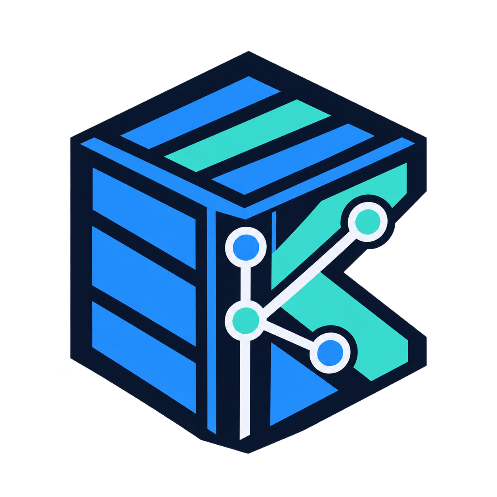
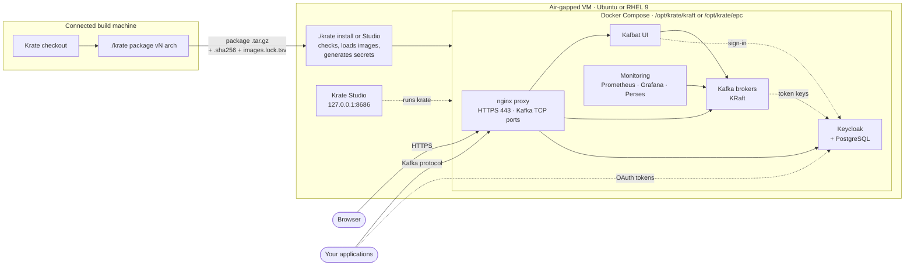
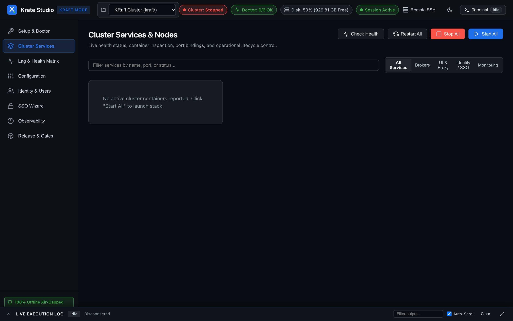

<a id="readme-top"></a>

<div align="center">
  

  <h1>Krate</h1>

  <p><strong>A complete Kafka platform in one offline package, for air-gapped Ubuntu and RHEL virtual machines.</strong></p>

  <p>
    <a href="https://github.com/bso-d/Krate/actions/workflows/broker-ci.yml">
      
    </a>
    <a href="https://github.com/bso-d/Krate/actions/workflows/codeql.yml">
      
    </a>
    
    
    <a href="LICENSE"></a>
  </p>

  <p>
    <a href="#quick-start">Quick start</a> ·
    <a href="#install-offline">Install offline</a> ·
    <a href="https://github.com/bso-d/Krate/releases">Downloads</a> ·
    <a href="#documentation">Docs</a> ·
    <a href="https://github.com/bso-d/Krate/discussions">Discussions</a>
  </p>
</div>

<details>
  <summary>Contents</summary>

- [What Krate is](#what-krate-is)
- [How it works](#how-it-works)
- [Editions](#editions)
- [Requirements](#requirements)
- [Quick start](#quick-start)
- [Install offline](#install-offline)
- [Everyday commands](#everyday-commands)
- [Security and identity](#security-and-identity)
- [Monitoring](#monitoring)
- [Krate Studio](#krate-studio)
- [How configuration works](#how-configuration-works)
- [Limits](#limits)
- [Repository layout](#repository-layout)
- [Development and releases](#development-and-releases)
- [Documentation](#documentation)
- [Community and support](#community-and-support)
- [Credits](#credits)
- [License](#license)

</details>

## What Krate is

[Apache Kafka](https://kafka.apache.org/) stores and delivers streams of messages between applications. Running it well on a machine with **no internet access** is hard: images can't be pulled, the operating system may lack Docker, and the UI, single sign-on and monitoring each need their own setup.

Krate solves this with two steps:

1. **On a connected machine**, `./krate package` collects every digest-pinned container image, the setup files, and optionally the Docker installation packages into one compressed package, with a checksum and an image lock file.
2. **On the target VM**, `./krate install` (or the **Install** button in [Krate Studio](#krate-studio)) checks the host, loads the images, generates every password and certificate, starts the cluster, waits until it's healthy and prints the logins. Nothing is downloaded.

What you get:

- **A Kafka cluster** (KRaft, no ZooKeeper) on Docker Compose: four brokers, or two on the RHEL edition.
- **[Kafbat UI](https://github.com/kafbat/kafka-ui)** for brokers, topics and consumer groups, behind an nginx proxy with HTTPS. It's a customized build with a native login page and Keycloak sign-in.
- **Keycloak SSO** with an optional PingFederate broker and automatic fallback to local login when the enterprise identity provider is down.
- **Opt-in Kafka security**: TLS and OAuth on the Kafka listeners, backed by the same Keycloak realm, with least-privilege application identities that rotate their own secrets.
- **Two monitoring paths**: Grafana with Loki, and Perses with VictoriaLogs, sharing Prometheus, exporters, alert rules and Kafka security signals.
- **One command-line tool**, `krate`, for installation, health, logs, consumer lag, users, secrets, backups and certificates, plus **[Krate Studio](#krate-studio)**, a local browser-based control panel for the same operations.

## How it works



- **The proxy is the only front door.** It serves the UI, the Keycloak sign-in pages and (in realm mode) Grafana over HTTPS, and passes Kafka client connections through to the brokers. The brokers publish no host ports of their own.
- **Private networks keep the parts apart.** Keycloak, its database, the proxy and Kafbat share an internal `identity` network with no route outside. Keycloak trusts forwarded headers only from the proxy's fixed address. The brokers reach Keycloak's signing keys over a separate internal `kafka-auth` network.
- **Every image is pinned by digest** in the edition's `.env.template`. The package stores exactly those images, and the lock file records their checksums and processor type.
- **Site state lives in the installation directory** (`/opt/krate/kraft` or `/opt/krate/epc`): `.env`, `monitoring/.env`, certificates and SSO files. A newer package replaces only the release files, so settings, passwords and stored messages survive updates.

## Editions

| Edition | Brokers | Message storage | Intended host | Command |
| --- | --- | --- | --- | --- |
| **KRaft** (default) | 4 combined broker/controller nodes; replication factor 3, min in-sync 2 | Docker volumes | Ubuntu 22.04 or 24.04, x86_64 or ARM64 | `kraft/krate` |
| **EPC** | 2 combined nodes; replication factor 2, min in-sync 1 | A dedicated, verified ext4 or XFS filesystem at `/data`, with a disk budget | RHEL 9, x86_64 or ARM64 | `epc/krate` |
| ZooKeeper (legacy) | ZooKeeper + Confluent images | Docker volumes | Existing users only | `zk/kafka` |

KRaft and EPC are the active editions. EPC adds a storage guard (brokers start only on the expected filesystem; see the [EPC storage guide](epc/storage.md)), a per-partition size cap, explicit topic creation by default, and `./krate disk` to compare data-disk use with its budget. The `zk/` edition is frozen: it still builds, but gets no new features.

### Downloads

Ready-made packages are on the [releases page](https://github.com/bso-d/Krate/releases). Two kinds of release exist, so check the tag before downloading:

| Kind | Tags | What you get |
| --- | --- | --- |
| **Offline install package** | `package-kraft-vN`, `package-epc-vN` | A `.tar.gz` for one processor, its `.sha256`, the image lock file, and a `-sources.tar` with the corresponding source of the copyleft components in its images |
| **Broker images** | `kraft-vX.Y.Z`, `zk-vX.Y.Z` | Image references on GHCR. Nothing to install; the default setups don't use these images |

The current packages are [`package-kraft-v6`](https://github.com/bso-d/Krate/releases/tag/package-kraft-v6) (Ubuntu 24.04) and [`package-epc-v6`](https://github.com/bso-d/Krate/releases/tag/package-epc-v6) (RHEL 9). Each release's notes cover upgrading from earlier packages. For another OS or processor combination, [build a package](#1-build-the-package) yourself.

## Requirements

| To… | You need |
| --- | --- |
| Run a cluster | Docker Engine 25.0.3+ and Docker Compose (the `docker compose` plugin, or `docker-compose` 1.29.2+). SSO needs Compose 2.20.2+ |
| Create certificates | OpenSSL, or your own `certs/server.crt` and `certs/server.key` |
| Run monitoring, SSO or Studio | Python 3.9+ on the host |
| Build from a checkout or build packages | A connected machine with Docker, Bash, Git, Python 3, Node.js and npm (for the Kafbat UI image), JDK 21 (for the Kafka OAuth application client), and GNU Make 4.0+ (`brew install make` on macOS) |
| Connect applications with OAuth | Java 17+ on application hosts for the callback jar. Offline packages bundle a pinned OpenJDK 21 runtime for operator commands and Studio; a source checkout needs Java 17+ for those |

Pick the package for the VM's processor (`amd64` for x86_64, `arm64` for ARM64), and leave disk space for the package, the loaded images and your messages.

## Quick start

On a machine with internet access:

```bash
git clone https://github.com/bso-d/Krate.git
cd Krate/kraft
./krate start
./krate credentials
```

The first `start` creates `.env` and `monitoring/.env`, generates every password and secret, makes a self-signed certificate, builds the Kafbat UI image (several minutes), downloads the other images and starts the cluster. `credentials` prints every address and login. Open the Kafbat UI address to see the four brokers.

The certificate is self-signed, so your browser will warn about it. That's fine for a trial; see [certificates](#certificates-and-the-public-url) for production. To set the UI host name first, run `./krate config set KAFKA_UI_FQDN=kafka.example.com`.

## Install offline

### 1. Build the package

On the connected machine, from `kraft/` (or `epc/` for EPC):

```bash
./krate package v1 amd64          # for an x86_64 VM
./krate package v1 arm64          # for an ARM64 VM
./krate package v1 amd64 none     # without Docker installation packages
```

`v1` is your label for the package. The last argument picks the bundled Docker packages: `noble` (Ubuntu 24.04, the KRaft default), `jammy` (Ubuntu 22.04), `rhel9` (the EPC default) or `none`. The result goes to `dist/release/package-<edition>-v1/`:

```text
krate-kraft-v1-amd64.tar.gz
krate-kraft-v1-amd64.tar.gz.sha256
krate-kraft-v1-amd64.tar.gz.images.lock.tsv
krate-kraft-v1-amd64.notes.md
```

<details>
<summary>How the bundled Docker packages are resolved on RHEL</summary>

`make docker-rpms` downloads Docker CE plus the base-OS packages a minimal host may lack (`container-selinux`, `nftables`, `iptables-nft` and their libraries) into `optional/`, using a digest-pinned Rocky Linux 9 builder image. `./krate docker-install` adds an optional package only when it provides something `dnf` reports missing on that host, round by round. Anything still unresolved is named, so you can take it from the OS media. `container-selinux` must match the host's `selinux-policy` build. On Ubuntu, the installer uses `dpkg` and may try `apt-get` to repair missing dependencies, so check that the OS dependencies are present first.

</details>

### 2. Install on the VM

Copy the package and its `.sha256` file to the VM, then verify and extract it:

```bash
sha256sum -c krate-kraft-v1-amd64.tar.gz.sha256    # should print OK
tar -xzf krate-kraft-v1-amd64.tar.gz
cd krate-kraft-v1-amd64
```

**EPC first:** mount the independently verified, dedicated ext4 or XFS filesystem read-write at the exact broker data mountpoint (normally `/data`), make that mount persistent across boots, and stage its expected path and UUID **in the extracted package's own `.env`** as described in [first install from an extracted EPC package](epc/storage.md#first-install-from-an-extracted-epc-package). Don't use `./krate config set` from the package for these pins: it forwards to an existing installation and fails when there is none. Existing broker data on the root disk needs a verified migration; mounting an empty disk over it doesn't move the data.

Then install, either from the command line:

```bash
./krate docker-install     # only if Docker is missing (needs administrator access)
./krate doctor             # Docker, architecture, certificates, ports, firewall
./krate install
```

or guided by Krate Studio: run `./krate studio --no-browser` and follow [Studio-guided setup](#studio-guided-setup).

`install` repeats the `doctor` checks, loads the images, installs into `/opt/krate/kraft` (`/opt/krate/epc` for EPC; set `KRATE_HOME` to choose another directory), prepares settings, passwords and the certificate, starts the cluster, waits for it to be healthy and prints every login. The default installation directories must be real directories, not symlinks.

### 3. Update to a newer package

Unpack the new package anywhere and run its `./krate install`, with the cluster running or stopped. It replaces only the release files and loads the new images. Settings, passwords, certificates, SSO files and stored messages stay, and new image pins and settings are added automatically. The Docker project is always `krate-kraft` or `krate-epc`, so data volumes keep their names whichever directory a package was unpacked to. On EPC, follow the [upgrade steps in the storage guide](epc/storage.md#upgrade-an-existing-site) from the installed workspace, and never replace the expected UUID just to make a failing check pass.

Installations from before `/opt/krate` are found through their containers and taken over automatically. If the old containers are already gone, name the old directory with `./krate install --from /path/to/old-package`.

## Everyday commands

Run these in the installation directory or in a checkout's `kraft/` or `epc/`. From an extracted package they act on the installation. `./krate help` lists everything.

| Command | What it does |
| --- | --- |
| `./krate credentials` | Every address and login: Kafbat UI, Grafana, Perses and, with SSO, Keycloak |
| `./krate status` / `./krate health` | Service state / health, waiting for services still starting |
| `./krate logs -f kafka-92` | Follow one service's logs |
| `./krate lag [group] [--topic T]` | Messages consumer groups still have to read |
| `./krate start` / `stop` / `restart [service]` / `down` | Lifecycle; stored messages are kept |
| `./krate config {get\|set\|list}` | Read or change settings in `.env` |
| `./krate gen-cert` | Generate a self-signed development certificate |
| `./krate identity …` | Keycloak: `up`, `status`, `users`, `rotate`, `backup`, `restore`, `recover-admin`, `idp-watch`, `renew-db-tls`, `logrotate` |
| `./krate auth configure` / `auth apply` | Plan and apply Kafbat's sign-in mode |
| `./krate kafka auth {enable\|status\|disable}` / `kafka renew-tls` | Kafka listener TLS and OAuth |
| `./krate kafka client {register\|status\|rotate\|recover\|grant\|template\|enroll}` | Application identities and their topic and group ACLs |
| `./krate monitor {up\|down\|status\|logs\|reload\|ui}` | The monitoring stack |
| `./krate studio` | Start Krate Studio |
| `./krate uninstall [--purge]` / `clear-cluster` / `clear-images` | Remove containers, data or images |
| `./krate disk` | EPC only: data-disk use against the budget |

## Security and identity

Krate's defaults favour safe operation on a shared VM: every password and secret is generated, never a shared default; secrets travel through environment variables, files with mode `0600` or standard input rather than command lines; and every image is pinned by digest.

### Proxy

- HTTPS on `443` (TLS 1.2+), with `80` only redirecting. Security headers and a content security policy are set on every response, and sign-in endpoints are rate limited.
- In Keycloak sign-in mode, a request whose `Host` header (name or port) isn't the public host is closed without a response, so links and redirects can't be built from a host a client chose. Use the issued host name and port for browser login, not a raw IP address or an unrelated tunnel URL.
- Only the `krate` realm's pages are reachable. The Keycloak admin console, its REST API, Kafbat's actuator and metrics endpoints are not exposed.

### Certificates and the public URL

- **Development certificate:** `./krate gen-cert` (or the first start) creates a self-signed certificate for the host FQDN, the `KEYCLOAK_PUBLIC_URL` host and `localhost`. Use it for development and fixtures only.
- **Production certificate:** put the CA-issued leaf followed by its intermediate chain in `certs/server.crt`, and its matching unencrypted key in `certs/server.key` with mode `0600`, owned by the Krate operator. The certificate must name the host clients actually use; an IP address needs an IP entry. Distribute your enterprise CA through your normal trust process; don't bypass browser warnings or trust the leaf directly.
- **Renewing without changing the origin:** install the complete new pair, then run `./krate start` (or `./krate auth apply` with Keycloak) to reload the proxy, and `./krate monitor up` if Grafana or Perses use Krate sign-in. A partial pair fails closed. Never run `gen-cert` over an issued certificate.
- **Changing `KEYCLOAK_PUBLIC_URL`:** set the exact client-facing HTTPS host and port with the `/identity` path, install a valid certificate for that name and run `./krate identity up`. For local Keycloak sign-in, then run `./krate auth configure --force` and `./krate auth apply`. With PingFederate, keep your site plan and follow the [broker procedure](sso/guides/dual-login.md). Finish with `./krate monitor up` if the dashboards use Krate sign-in.
- **Verify from the operator network:** `python3 -B sso/check-public-origin.py --workspace /opt/krate/kraft` (or `--public-url https://kafka.example.com/identity` from a workstation without the server's `.env`) makes a read-only discovery request and requires a trusted chain, a matching host and the exact realm issuer. It uses normal CA trust unless you pass `--ca-file`. Run it over the same DNS and network path as your operators; a success on the host itself doesn't prove workstation access.

### Sign-in for Kafbat UI

```bash
./krate identity up      # bootstrap Keycloak and its database; creates the admin
./krate auth configure   # or: ./krate auth configure site.json  (adds PingFederate)
./krate config set KAFKA_UI_AUTH_CONFIG=runtime.yml
./krate auth apply
```

- **Default (`local.yml`):** one shared admin login on Kafbat's own page.
- **Keycloak (`runtime.yml`):** sign-in through the local `krate` realm only; realm groups (`KRATE_VIEWERS`, `KRATE_ADMINS`) decide Viewer and Admin access. Manage users with `./krate identity users {list|add|enable|disable|reset-password|groups|logout|set-email}`.
- **PingFederate brokering:** with a site file, `./krate auth configure site.json` also writes the PingFederate plan `auth/keycloak/pingfederate-idp.json`, which `./krate auth apply` applies to the realm. The site file must state the MFA stance: a claim PingFederate asserts, or `mfa_not_asserted`. Every login then redirects to PingFederate, and brokered users are created without linking to local accounts.
- **Break-glass login:** local realm users can still sign in by pressing Kafbat's **Log in with Keycloak** button and appending `&kc_idp_hint=` (empty) to the realm's authorization URL. The [operator setup guide](sso/guides/dual-login.md) describes the full procedure.
- **What `auth apply` does:** it validates the installation and reconciles the UI service and the proxy from locally loaded images. It never bootstraps Keycloak; if the realm isn't ready, it stops and tells you to run `./krate identity up`. In `runtime.yml` mode it recreates the running Keycloak container when the trust material in `auth/keycloak/truststores` or Keycloak's Compose definition changed (which ends Keycloak sessions), then applies or removes the PingFederate plan in the realm.
- **Automatic fallback (`idp-watch`):** while PingFederate is active, a watcher probes its endpoints. When they fail, it switches sign-in to the local Keycloak form (password and one-time code), and the login page shows an outage warning so corporate users don't type directory passwords there. When PingFederate recovers, it switches back. Control it with `./krate identity idp-watch {status|reset|pause|resume}`.
- Keycloak's database uses TLS with certificate verification, backups are encrypted, and every identity secret can be rotated with `./krate identity rotate`.

### Kafka client authentication

A new cluster starts with **unauthenticated plaintext** Kafka listeners (`KAFKA_AUTH_MODE=local`). Run `./krate kafka auth enable` after `./krate identity up` to switch to `oauth_ssl`, and check `./krate kafka auth status` and every application client before exposing broker ports to other machines. Studio shows the current mode and offers the same transition.

- The external listener becomes TLS (`SASL_SSL`), and every listener requires authentication; no listener accepts anonymous clients.
- Krate creates a local CA and broker certificates. Clients trust `certs/kafka/ca.crt`, and `./krate kafka renew-tls` renews the certificates broker by broker with rollback.
- Applications sign in with OAuth (`SASL/OAUTHBEARER`) as Keycloak clients with the `kafka` scope, under a realm policy that limits client-secret lifetime and forces rotation.
- Kafbat UI and kafka-exporter get their own least-privilege identities. Switching modes recreates the brokers and Kafbat but keeps stored messages.

#### Give an application scoped Kafka access

Create the application's topic with a Kafka administrator before its first send; application clients get only the topic and group ACLs they ask for and can't create topics. On the four-broker KRaft cluster, for example:

```bash
docker exec krate-broker-92 /opt/kafka/bin/kafka-topics.sh \
  --bootstrap-server kafka-92:9092 \
  --command-config /mnt/shared/config/admin.properties \
  --create --topic payments --partitions 1 --replication-factor 3
mkdir -m 700 auth/payments-client
./krate kafka client register --client-id payments-client \
  --state "$PWD/auth/payments-client/state.json" \
  --access read-write --topic payments --group payments-consumers
./krate kafka client status --state "$PWD/auth/payments-client/state.json"
```

- **Keep the state private.** The state directory and its `0600` state file hold the client's credentials. Never paste state or registration JSON into Studio or logs.
- **Connect with the callback jar.** Configure the application with the [OAuth client callback](kafka-oauth-client/README.md), which re-reads rotated credentials on every token refresh. Then verify a message is actually consumed: a producer can exit successfully even when its send was denied.
- **Maintain it:** `kafka client rotate --state …` checks rotation, and `kafka client recover --state … --admin` repairs the private registration token from Keycloak.
- **Tooling is bundled.** Offline packages include the client jar, its pinned libraries and a Java runtime, so these commands work without installing Java on the offline host. From a source checkout, build the jar first and set `KAFKA_OAUTH_CLIENT_HOME` to its directory before starting the CLI or Studio.

<details>
<summary>Studio-managed clients and moving a client into Studio</summary>

Studio manages clients by ID. For each installed workspace it keeps their state under the Studio user's `~/.krate-studio-clients/`, and its Status screen shows the exact location. Registration creates `0700` directories and a `0600` state file. A state file the CLI created elsewhere keeps working from the CLI, but Studio won't select it. To move a former Studio client into the managed location:

1. Stop the consuming application, and avoid Studio rotation or recovery while copying. Two active copies share a registration token and secret; rotating one can strand the other.
2. Use Studio **Check Status** with the client ID to show the managed destination. Check that the old file is a regular `0600` file owned by the same desktop user, then copy it to the destination under `0700` parent directories, keeping `0600` on the new file.

   As the user running Studio, set `OLD_STATE` to the existing state file and `DESTINATION` to the exact location **Check Status** shows, then run this one-time copy. It refuses a wrong destination shape, an unsafe source, weak or linked directories and an existing destination, and it prints no credential data:

   ```bash
   OLD_STATE=/private/old/state.json DESTINATION=/home/operator/.krate-studio-clients/WORKSPACE_HASH/CLIENT_HASH/state.json python3 - <<'PY'
   import os, re, shutil, stat
   from pathlib import Path
   def require(ok, message):
       if not ok: raise SystemExit(message)
   old, dest = Path(os.environ['OLD_STATE']), Path(os.environ['DESTINATION'])
   root = Path.home() / '.krate-studio-clients'
   parts = dest.relative_to(root).parts
   require(len(parts) == 3 and parts[2] == 'state.json', 'Unexpected managed destination')
   require(all(re.fullmatch(r'[0-9a-f]{64}', part) for part in parts[:2]), 'Unexpected managed destination')
   source = os.lstat(old)
   require(stat.S_ISREG(source.st_mode) and source.st_uid == os.geteuid(), 'Old state is not a same-user regular file')
   require(stat.S_IMODE(source.st_mode) == 0o600, 'Old state must have mode 0600')
   for directory in (root, root / parts[0], root / parts[0] / parts[1]):
       try: os.mkdir(directory, 0o700)
       except FileExistsError: pass
       info = os.lstat(directory)
       require(stat.S_ISDIR(info.st_mode) and info.st_uid == os.geteuid(), 'Managed directory is unsafe')
       require(stat.S_IMODE(info.st_mode) == 0o700, 'Managed directory must have mode 0700')
   with os.fdopen(os.open(old, os.O_RDONLY | os.O_NOFOLLOW), 'rb') as src:
       with os.fdopen(os.open(dest, os.O_WRONLY | os.O_CREAT | os.O_EXCL | os.O_NOFOLLOW, 0o600), 'wb') as dst:
           shutil.copyfileobj(src, dst)
   PY
   ```

3. Confirm **Check Status** reports the expected ID and `krate kafka client status --state DESTINATION` succeeds. If a rotation is pending, run `krate kafka client recover --state DESTINATION --admin` before resuming.
4. Point the application's JAAS `credentialStateFile` at the new destination, restart it, and verify a real message is produced or consumed. Keep the old private file only as a rollback until the new callback is proven, then retire it.

A client running under another user should keep its existing CLI path, unless you deliberately migrate its state under that user's account.

</details>

The [identity guides](#documentation) cover the trust model, every procedure and the acceptance gate in detail.

## Monitoring

```bash
./krate monitor up
./krate monitor ui       # addresses and logins
```

Prometheus collects broker, consumer group and host metrics and evaluates the alert rules. Fluent Bit collects container logs. Two dashboard paths run side by side:

| Path | Dashboards | Logs | Alert email |
| --- | --- | --- | --- |
| Grafana | Grafana on `3000` (behind the HTTPS proxy at `/grafana/` in realm mode) | Loki | Grafana |
| Perses | Perses on `3443`, HTTPS with the cluster certificate | VictoriaLogs | Alertmanager |

- **Dashboard sign-in:** both dashboards can sign users in through the Krate realm: `GRAFANA_AUTH_CONFIG=realm.ini` after `./krate monitor realm`, and `PERSES_IDP=krate` with `PERSES_AUTH_MODE=native`.
- **Kafka security signals:** a probe checks the certificate each external Kafka listener serves, and alerts on failed TLS verification and certificates expiring within 30 days. Denied authorization events and invalid SCRAM credentials from the brokers raise alerts through the Loki ruler.
- **Endpoints without login:** Prometheus (`9090`) and Loki (`3100`) have none, so they're bound to `127.0.0.1` by default.
- **Reloading rules:** after editing `prometheus.yml` or `alerts.yml` in place, `./krate monitor reload` reloads Prometheus and confirms it accepted the change.
- **Email:** alert email is off until you configure your own mail server.

See the [monitoring guide](monitoring/README.md).

## Krate Studio

<p align="center">
  
</p>

Krate Studio is a browser-based control panel for the same operations the `krate` command runs. Start it with `./krate studio`, or from an extracted package double-click `Krate-UI.command` (macOS), `Krate-UI.bat` (Windows) or `Krate-UI.desktop` / `krate-ui.sh` (Linux). It needs Python 3.9+.

- **Views:** setup and preflight checks, services, consumer lag, configuration, identity and users (including Kafka OAuth and managed application clients), an SSO wizard, observability, and release verification, with a live terminal drawer for every operation.
- **No drift from the CLI:** each action runs the installation's own `krate`, and only one changing operation runs at a time.
- **Locked down by default:** it listens on `127.0.0.1:8686` only (`--host`/`--port` or `KRATE_UI_HOST`/`KRATE_UI_PORT` change that). A private startup token becomes a session cookie, and every change needs a CSRF header. One-time passwords are shown once and kept out of logs. To use Studio from another machine, tunnel over SSH rather than opening the port.

### Studio-guided setup

Studio runs from the extracted package, so copy, verify and extract the package first (and, on EPC, prepare storage as in [step 2](#2-install-on-the-vm)). Then:

```bash
./krate studio --no-browser
```

Use the URL and private token it prints. On a remote host, keep Studio on loopback and tunnel from your workstation (replace the user and host):

```bash
ssh -L 8686:127.0.0.1:8686 -L 8443:127.0.0.1:443 user@host
```

1. **Open Studio.** Open the exact **Access URL** Studio printed. Its `?token=` parameter authenticates your browser, so keep the URL private.
2. **Install.** In **Setup & Doctor**, click **Install Docker** if needed, optionally **Load Images**, then **Install**. Confirm **Certificate Present** and **Production Live**. **Start Cluster** brings it back after a stop.
3. **Turn on the services.** In **Cluster Services**, start **Identity / SSO**. In **Identity & Users**, enable OAuth/TLS. In **Observability**, start monitoring.
4. **Open Kafbat.** Use the portal link if its host name resolves from your workstation. Otherwise, with the default local sign-in, open `https://127.0.0.1:8443/` through the second tunnel. Expect a certificate warning until you install a trusted certificate.

**Install Interrupted** means an install didn't finish. **Files Present; Verify** on an older installation means there's no completion record, so check its health before use.

### Keep Studio running after a reboot

On a systemd host, after installing Krate, run Studio as a service under your existing non-root Krate operator. That account needs access to the installed workspace and the Docker socket; Docker group membership is root-equivalent, so grant it only to trusted administrators. From the installed workspace, with `variant` set to `kraft` or `epc`:

```bash
variant=kraft
sudo install -m 0644 ui/krate-studio@.service.example /etc/systemd/system/krate-studio@.service
sudoedit /etc/systemd/system/krate-studio@.service  # Set User= to the existing Krate operator
sudo systemctl daemon-reload
sudo systemctl enable --now "krate-studio@${variant}.service"
systemctl is-active "krate-studio@${variant}.service"
```

The template assumes `/opt/krate/<variant>` and one Studio per host on port 8686. For another install path, change both `WorkingDirectory=` and `ExecStart=`, and close any foreground Studio on that port first. Keep the service on loopback.

After a reboot, reconnect the tunnel and read the fresh link **as the configured operator**:

```bash
cat "/run/krate-studio-${variant}/access-url"
```

The token changes at every service start, so old links and sessions stop working. The URL is kept in an operator-only `0600` file, never in the journal; use `systemctl status` or `journalctl -u "krate-studio@${variant}.service" -b` to check startup without exposing it. Restarting Studio doesn't start or certify the cluster, so check cluster health separately.

**Docker group changes:** after Studio installs Docker and adds the operator to the `docker` group, existing shells don't pick up the group. Reconnect SSH or use `newgrp docker`, then confirm with `id -Gn` and `docker info`. Restart the Studio service if the operator's group membership changed while it was running.

## How configuration works

- **Settings live in `.env`** (and `monitoring/.env`). Change them with `./krate config set KEY=VALUE`, then run `./krate start` to apply. Certificate and public-URL changes have their own [procedures](#certificates-and-the-public-url).
- **Image pins belong to the release.** Every command that runs Docker Compose first resets the `*_IMAGE` lines in `.env` to the pins in `.env.template`, so a new package or rebuilt UI image takes effect without editing `.env`. To use a different image, change the template.
- **Secrets are generated once.** Empty or placeholder values are filled with random secrets. Keycloak and Grafana keep the values they first started with, so change those only with `./krate identity rotate` or in Grafana itself.
- **Purging data:** `./krate uninstall --purge` deletes the KRaft and ZooKeeper message volumes. EPC keeps messages in `KAFKA_DATA_DIR`, so deleting them means stopping the cluster and removing the broker folders yourself.

## Limits

- **One VM is one point of failure.** Several brokers on one host don't protect against losing that host. EPC's two-node controller group also needs both nodes to agree.
- **Kafka security is opt-in.** Listeners are unauthenticated plaintext until `./krate identity up` and `./krate kafka auth enable` complete. Don't expose broker ports to other machines before that.
- **Remote clients need the advertised host set.** Brokers advertise `localhost` by default. For clients on other machines, set `KAFKA_ADVERTISED_HOST` to this host's name or IP and run `./krate start`. The ZooKeeper edition needs its Compose listeners changed instead.
- **Some monitoring endpoints use HTTP.** Grafana uses plain HTTP on `3000` unless realm mode moves it behind the proxy; Prometheus and Loki stay on loopback.
- **Disk use grows with messages and topics.** Size the disk for your retention; EPC's budget section in `.env.template` shows the arithmetic.
- **A healthy package isn't a verified site.** Healthy containers don't prove your network, remote clients, storage capacity or email delivery work; check those on the target VM.

## Repository layout

```text
kraft/               Four-broker KRaft edition: Compose file, nginx configs, krate CLI
epc/                 Two-broker RHEL edition: Compose file, nginx configs, storage guard, krate CLI
zk/                  Frozen ZooKeeper edition and its kafka CLI
monitoring/          Shared monitoring stack: Prometheus, Grafana, Loki, Perses, Fluent Bit, security probe
sso/                 Identity planning, Kafka broker auth, preflight checks, idp-watch, login theme, guides
kafka-oauth-client/  OAuth login callback jar for application clients
kafbat-ui/           Customized Kafbat UI build and patches
ui/                  Krate Studio backend, web interface and systemd template
docker/              Broker image definitions (release and debug)
scripts/             Package release, bundle and offline checks, acceptance gate, source collection
Makefile             Package builds, Docker package downloads and source checks
```

## Development and releases

```bash
make help
make check     # gmake check on macOS
```

`make check` runs Bash syntax checks, ShellCheck, and validation of the Compose files, offline defaults and identity templates. It doesn't start a cluster. The identity work is accepted through an executable gate, `scripts/gate-identity.sh` (see the [gate guide](sso/guides/identity-gate.md)). The [broker CI workflow](.github/workflows/broker-ci.yml) builds the broker images and checks message delivery.

To release an offline package, run `scripts/package-release.sh <edition> <vN> <arch> [docker-os]` locally first. Then start **Release offline install packages** from `main` in GitHub Actions with the same inputs. The workflow creates the `package-<edition>-vN` tag and refuses versions that already exist. Broker images use the separate [broker release workflow](.github/workflows/broker-release.yml).

## Documentation

| Guide | Covers |
| --- | --- |
| [Identity foundation](sso/guides/identity-foundation.md) | Projects, ports, volumes, credentials, trust boundaries, procedures, Kafka OAuth reconciliation |
| [Operator SSO setup](sso/guides/dual-login.md) | Keycloak sign-in, PingFederate brokering, MFA claims, `idp-watch`, break-glass login |
| [PingFederate IAM guide](sso/guides/pingfederate-iam-guide.md) | What the IAM team configures in PingFederate |
| [SSO flows](sso/guides/sso-flows.md) | Sign-in and sign-out flows end to end |
| [Grafana SSO](sso/guides/grafana-sso.md) / [Perses SSO](sso/guides/perses-sso.md) | Dashboard sign-in through the Krate realm or a company IdP |
| [Kafka OAuth client](kafka-oauth-client/README.md) | Building and configuring the application callback jar |
| [EPC storage](epc/storage.md) | Dedicated filesystem, storage pins, first install and upgrades on EPC |
| [Identity acceptance gate](sso/guides/identity-gate.md) | Gate criteria, test inventories and receipts |
| [Monitoring](monitoring/README.md) | Both monitoring paths, ports, reloads, log collection, Kafka security signals |
| [Kafbat UI build](kafbat-ui/README.md) | The customized UI build and its security patches |
| [License sources](LICENSE-SOURCES.md) | Where the source of each copyleft component is published |

## Community and support

- **Questions, ideas and deployment stories:** [GitHub Discussions](https://github.com/bso-d/Krate/discussions).
- **Reproducible bugs and concrete feature requests:** [issues](https://github.com/bso-d/Krate/issues), using the templates. Include the edition, package version, processor and OS, Docker and Compose versions, and `./krate doctor` output. Redact passwords, secrets, certificates and internal host names.
- **Security vulnerabilities:** report privately through the [Security Policy](.github/SECURITY.md), never in public.
- **Contributing:** see [CONTRIBUTING.md](CONTRIBUTING.md). Everyone taking part follows the [Code of Conduct](CODE_OF_CONDUCT.md).

## Credits

Krate builds on the work of these projects; each keeps its own license and notices.

| Component | Used for |
| --- | --- |
| [Apache Kafka](https://kafka.apache.org/) and [ZooKeeper](https://zookeeper.apache.org/) | Message brokers and legacy coordination |
| [Kafbat UI](https://github.com/kafbat/kafka-ui) on [Eclipse Temurin](https://adoptium.net/) | Browser interface for Kafka (modified v1.5.0 build) |
| [Keycloak](https://github.com/keycloak/keycloak) and [PostgreSQL](https://www.postgresql.org/) | Identity service and its database |
| [nginx](https://github.com/nginx/nginx) | HTTPS proxy and Kafka TCP passthrough |
| [Prometheus](https://prometheus.io/), [Node Exporter](https://github.com/prometheus/node_exporter), [Alertmanager](https://github.com/prometheus/alertmanager), [Kafka Exporter](https://github.com/danielqsj/kafka_exporter) | Metrics and alerts |
| [Grafana](https://github.com/grafana/grafana), [Loki](https://github.com/grafana/loki), [Perses](https://github.com/perses/perses), [VictoriaLogs](https://github.com/VictoriaMetrics/VictoriaLogs), [Fluent Bit](https://github.com/fluent/fluent-bit), [OAuth2 Proxy](https://github.com/oauth2-proxy/oauth2-proxy) | Dashboards, logs and dashboard sign-in |
| [OpenJDK](https://openjdk.org/) and [Jackson](https://github.com/FasterXML/jackson) | The Kafka OAuth client callback and operator runtime |
| [Confluent images](https://github.com/confluentinc/cp-docker-images) | The legacy ZooKeeper edition |
| [Docker](https://www.docker.com/), [containerd](https://containerd.io/), [Ubuntu](https://ubuntu.com/), [RHEL](https://www.redhat.com/en/technologies/linux-platforms/enterprise-linux), [Rocky Linux](https://rockylinux.org/), [Alpine](https://www.alpinelinux.org/) | Runtime, target systems and package builds |
| [Bash](https://www.gnu.org/software/bash/), [GNU Make](https://www.gnu.org/software/make/), [Python](https://www.python.org/), [OpenSSL](https://openssl-library.org/), [ShellCheck](https://github.com/koalaman/shellcheck) | Tooling and checks |

## License

Krate is licensed under the [GNU Affero General Public License v3.0](LICENSE) (`AGPL-3.0-only`). If you modify Krate and let others use it over a network, you must offer them the source of your modified version.

The third-party software Krate runs and packages keeps its own license. Packages include `LICENSE`, `LICENSE-SOURCES.md` and the license and notice files of those components, and each KRaft and EPC package release (from `package-kraft-v2` and `package-epc-v4` on) carries the complete corresponding source of the copyleft components in its images as a `-sources.tar`.

**Exception:** the frozen ZooKeeper edition's upstream images contain six copyleft components whose source isn't publicly available. They are listed in [LICENSE-SOURCES.md](LICENSE-SOURCES.md#unresolved-components).

<p align="right"><a href="#readme-top">Back to top</a></p>
