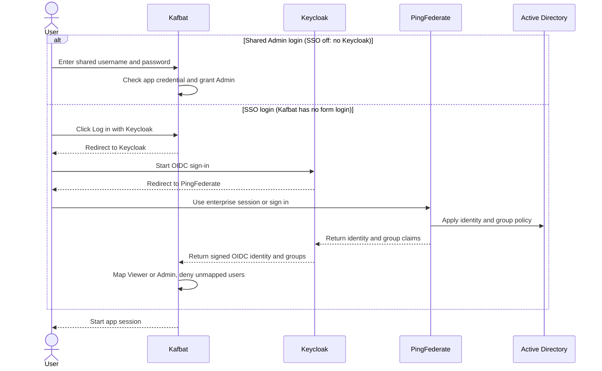
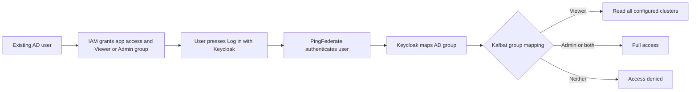
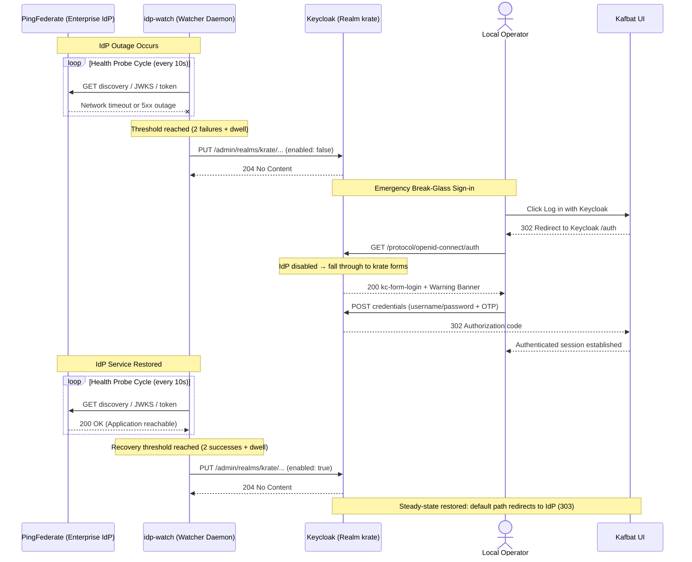

# Sign-in and enrollment

These flows apply to EPC and regular Krate.

There is no per-user enrollment in Kafbat. A group change takes effect at a
new sign-in. For urgent revocation, end active application sessions as well.

## Automatic IdP Fallback and Recovery

